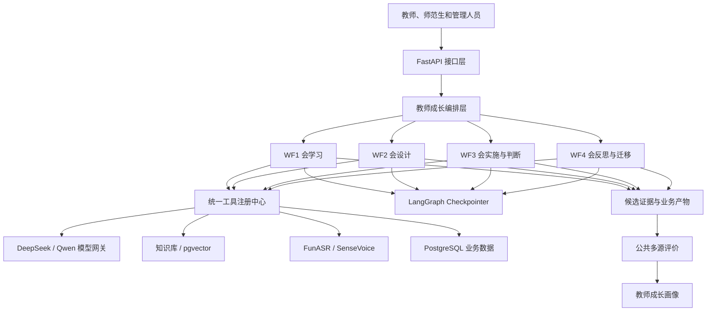

# 教师教育智能体

面向师范生与教师专业成长的智能支持工程。系统围绕“会学习、会设计、会实施与判断、会反思与迁移”四阶段培养链，使用 LangGraph 将培养流程转化为可执行、可暂停、可恢复、可追踪的工作流。

项目采用模块化单体、Clean Architecture、领域驱动设计和 Port/Adapter 外部能力适配。当前重点是通过显式状态、确定性路由、工具契约和人工复核，构建可解释、可审计的教育智能体系统。

## 四阶段培养链

```text
WF1 会学习
  → WF2 会设计
  → WF3 会实施与判断
  → WF4 会反思与迁移
  → 公共多源评价
  → 成长画像更新
  → 下一轮专业成长
```

| 工作流 | 工程名称 | 主要职责 |
| --- | --- | --- |
| WF1 会学习 | `wf1_cr_sdl_v3` | 目标设定、问题规划、认知冲突调节、探究、验证与反思 |
| WF2 会设计 | `wf2_instructional_design_v1` | 学习者分析、目标设计、内容设计、策略设计、教学过程与评价设计 |
| WF3 会实施与判断 | `wf3_teaching_implementation_judgment_v1` | 情境课堂、课堂执行、状态预警、支架调节、专业判断与再教学 |
| WF4 会反思与迁移 | `wf4_reflection_transfer_v1` | 证据反思、问题发现、归因解释、策略验证与迁移挑战 |

公共多源评价负责正式 Rubric 评分与综合评价，成长画像由独立业务过程更新。四条培养工作流只生成候选证据和阶段业务状态，并通过稳定契约衔接。

## 整体架构



系统采用以下边界：

- API 层处理协议、鉴权、参数和响应，不编写工作流业务规则。
- 工作流层负责节点、State、条件路由、中断、恢复和终态。
- 工具层负责可复用能力，不决定工作流下一步走向。
- 模型只生成建议、解释和候选证据，不决定权限、数据库事务、正式评分或终态。
- LangGraph Checkpointer 保存线程执行位置，业务数据库保存证据、任务和成长画像，两者分离。
- 四条工作流通过 `contracts/` 中的稳定契约通信，不读取彼此的内部 State。

## 当前实现状态

项目已经配置四个工具目录，共 122 个工具；四张原始流程图中的节点均已独立注册为 LangGraph 节点。

| 工作流 | 原图节点 | 补充节点 | 合计 |
| --- | ---: | ---: | ---: |
| WF1 会学习 | 52 | 0 | 52 |
| WF2 会设计 | 18 | 4 | 22 |
| WF3 会实施与判断 | 24 | 5 | 29 |
| WF4 会反思与迁移 | 36 | 6 | 42 |
| 合计 | 130 | 15 | 145 |

补充节点用于人工复核、取消、过期、失败和完成等工程终态。完整关系见[原图节点—LangGraph节点—工具—输入输出—路由对照表](docs/workflow-node-tool-route-mapping.md)。

工程同时包含：

- DeepSeek / Qwen 双模型网关；
- PostgreSQL 业务数据层；
- pgvector 向量检索；
- FunASR / SenseVoice 语音识别适配；
- DOCX、PDF、VSDX、TXT 和 Markdown 知识入库；
- PostgreSQL LangGraph Checkpointer；
- 工作流启动、恢复和状态查询 API；
- Docker Compose 与 Alembic 数据库迁移配置。

## 相对原有开发方式的优化

### 1. 从流程文档转为可执行节点

每个有独立业务意义的原图节点都对应一个 LangGraph 节点，并明确输入、输出、工具和条件路由。流程可以定位到具体节点维护，不再依赖一个大型函数顺序执行。

### 2. 四条工作流独立维护

四条工作流拥有独立目录、State、节点、路由和 Manifest：

```text
workflow_manifests/
├── wf1_manifest.py
├── wf2_manifest.py
├── wf3_manifest.py
├── wf4_manifest.py
└── shared.py
```

`workflows/manifests.py` 仅提供兼容导出，不在其中新增节点和路由。这种拆分可以减少多人协作时的 Git 冲突。

### 3. 建立统一工具契约

所有工具通过统一注册中心调用，并统一处理权限、输入校验、超时、重试、错误归一化、降级状态和证据引用。工作流只依赖工具契约，不直接依赖模型厂商或数据库实现。

### 4. 模型与业务规则分离

DeepSeek 主要承担复杂推理、认知冲突、证据分析和专业判断候选；Qwen 主要承担通用生成、内容组织和嵌入向量。确定性计算仍由程序完成，模型输出必须经过规则或人工复核。

### 5. 支持暂停、恢复和有限循环

需要教师确认的位置可以中断并在相同 `thread_id` 下恢复。修订、重试、再教学和迁移验证均设置次数上限，避免无限循环。

### 6. 为多人协作保留清晰边界

工作流、工具、领域、API 和基础设施分别管理。开发人员只修改自己负责的目录，公共注册、共享契约和部署文件由指定人员维护。

## 目录结构说明

```text
teacher-education-agent/
├── apps/
│   ├── api/                       # FastAPI 后端应用
│   ├── web/                       # 前端应用目录
│   └── worker/                    # 文档、音视频、评价等异步任务
├── configs/                       # 开发、测试、生产及功能开关配置
├── contracts/                     # API、事件、工具和跨工作流稳定契约
├── data/                          # 示例数据、种子数据和开发夹具
├── deploy/                        # Docker、FunASR、Kubernetes、Nginx 等部署文件
├── docs/                          # 架构、业务、迁移、操作和工作流文档
├── knowledge_base/                # 课程标准、案例、Rubric 等知识库内容
├── migrations/                    # Alembic 数据库迁移
├── model_artifacts/               # 模型制品清单，默认不提交大型模型文件
├── observability/                 # 日志、指标、告警和仪表盘定义
├── prompts/                       # 公共提示词及四条工作流的版本化提示词
├── scripts/                       # 映射导出、数据库、知识库和部署脚本
├── src/teacher_education_agent/   # 核心 Python 源码
├── tests/                         # 单元、契约、集成、安全和端到端测试目录
├── compose.yml                    # 本地 PostgreSQL、FunASR 和 API 编排
├── pyproject.toml                 # Python 依赖与工程配置
└── AGENTS.md                      # Codex 及开发人员必须遵守的工程规则
```

### `apps/`：应用入口

- `apps/api/`：对外提供 `/api/v1` 接口，负责工作流启动、恢复、状态查询和知识入库。
- `apps/web/`：前端工程，目前保留页面、组件、状态和服务目录。
- `apps/worker/`：承载不适合在 HTTP 请求内同步完成的耗时任务。

### `contracts/`：跨模块协议

这里保存模块之间允许交换的数据结构。跨工作流开发时应先修改契约，再修改生产方和消费方，不能让一条工作流直接导入另一条工作流的内部 State。

### `docs/`：设计与交付文档

- `docs/architecture/`：系统、模块、数据和部署架构。
- `docs/business/`：四阶段培养链和业务规则。
- `docs/source_extracts/`：原始 DOCX、VSDX 等资料的文本提取结果。
- `docs/workflow-node-tool-route-mapping.md`：原图节点与代码实现的完整对照表。
- `docs/GITHUB_DEVELOPER_COLLABORATION_GUIDE.md`：开发人员 GitHub 操作指南。

### `src/teacher_education_agent/`：核心代码

```text
src/teacher_education_agent/
├── agents/            # 专业智能体角色及其注册
├── application/       # 应用用例、命令、查询、DTO 和应用服务
├── core/              # 配置、安全、权限、日志、事务和幂等性
├── domains/           # 教师教育领域实体、值对象和领域服务
├── infrastructure/    # 数据库、Checkpointer、缓存、队列和持久化适配
├── integrations/      # 外部模型、消息、对象存储和旧系统适配
├── knowledge/         # 文档解析、切分、向量化、索引和检索
├── model_services/    # 大模型、嵌入、语音和视觉服务网关
├── orchestration/     # 四阶段培养链的跨工作流编排
├── tools/             # 四条工作流使用的具体工具
└── workflows/         # LangGraph State、节点、路由和图定义
```

### `workflows/`：工作流实现

```text
workflows/
├── shared/                                      # 多源评价、证据持久化等共享子流程
├── wf1_cr_sdl_v3/                               # 会学习
├── wf2_instructional_design_v1/                 # 会设计
├── wf3_teaching_implementation_judgment_v1/     # 会实施与判断
├── wf4_reflection_transfer_v1/                  # 会反思与迁移
├── workflow_manifests/                          # 四条工作流的节点和路由清单
├── detailed.py                                  # 通用详细图构建器
├── registry.py                                  # 工作流注册中心
└── composition.py                               # 工作流组合入口
```

每条工作流目录中的主要文件职责：

| 文件或目录 | 职责 |
| --- | --- |
| `state.py` | 定义工作流运行状态，只保存必要字段和引用 |
| `graph.py` | 创建并编译 LangGraph |
| `routes.py` | 保存确定性条件路由 |
| `nodes/` | 节点处理函数 |
| `subgraphs/` | 可复用的阶段子图 |
| `contracts.py` | 本工作流边界契约 |
| `policies.py` | 次数上限、权限和业务约束 |
| `specification.md` | 工作流设计说明 |

### `tools/`：工具实现

```text
tools/
├── common/              # 文档解析、OCR、安全、检索、语音和视频公共能力
├── wf1_learning/        # WF1 工具
├── wf2_design/          # WF2 工具
├── wf3_implementation/  # WF3 工具
├── wf4_reflection/      # WF4 工具
├── contracts.py         # ToolSpec、ToolContext、ToolResult
├── registry.py          # 权限、超时、重试和错误处理
├── foundation.py        # 通用确定性算法
└── bootstrap.py         # 工具统一注册入口
```

当前每条工作流的工具主要集中在 `catalog.py`。为了让两名工具开发人员并行工作，建议逐步调整为：

```text
wf*_*/
├── analysis_tools.py    # 分析、检测、分类、计算、比较和验证
├── action_tools.py      # 生成、推荐、检索、存储和外部服务
├── catalog.py           # 只汇总并注册上述工具
└── __init__.py
```

这是建议的下一步结构，尚未完成拆分前，不要把这些文件视为已经存在。

## 六人开发分工

建议采用“4 名工作流负责人 + 2 名工具负责人”，总人数为 6 人。

| 成员 | 主要职责 | 允许修改的核心目录 | 建议分支 |
| --- | --- | --- | --- |
| 成员1 | WF1 会学习的节点、State、路由、中断与恢复 | `workflows/wf1_cr_sdl_v3/`、`wf1_manifest.py` | `feat/wf1-workflow` |
| 成员2 | WF2 会设计的节点、State、路由和设计修订循环 | `workflows/wf2_instructional_design_v1/`、`wf2_manifest.py` | `feat/wf2-workflow` |
| 成员3 | WF3 会实施与判断的课堂事件、支架和再教学流程 | `workflows/wf3_teaching_implementation_judgment_v1/`、`wf3_manifest.py` | `feat/wf3-workflow` |
| 成员4 | WF4 会反思与迁移的证据、策略验证和迁移流程 | `workflows/wf4_reflection_transfer_v1/`、`wf4_manifest.py` | `feat/wf4-workflow` |
| 成员5 | 分析、检测、分类、计算、比较、评价和验证工具 | 四个工具目录中的 `analysis_tools.py` | `feat/analysis-tools` |
| 成员6 | 生成、推荐、检索、模型、存储和外部服务工具 | 四个工具目录中的 `action_tools.py` | `feat/service-tools` |

### 成员1：WF1工作流负责人

- 维护 52 个 WF1 原图节点。
- 负责目标设定、问题规划、认知冲突、探究、验证和反思路由。
- 设置回退、重试和循环次数上限。
- 调用 WF1 工具，但不修改工具算法。
- 更新对照表中的 WF1 部分。

### 成员2：WF2工作流负责人

- 维护 18 个原图节点和 4 个补充节点。
- 负责学习者分析、教学目标、内容、策略、过程和评价设计。
- 维护一致性检查与设计修订路由。
- 调用 WF2 工具并核对输入输出。

### 成员3：WF3工作流负责人

- 维护 24 个原图节点和 5 个补充节点。
- 负责实践配置、情境课堂、课堂事件、状态预警和支架控制。
- 负责专业判断、证据回放和有限次数的再教学。
- 对执行控制节点保留人工授权。

### 成员4：WF4工作流负责人

- 维护 36 个原图节点和 6 个补充节点。
- 负责反思证据、问题发现、归因解释和策略选择。
- 负责实践验证、迁移挑战、教学研究循环和阶段成果。
- 核对输出到公共评价和成长画像的契约。

### 成员5：分析、检测与评价工具负责人

主要负责以下类型：

```text
*_assessor     *_analyzer     *_detector
*_classifier   *_checker      *_validator
*_calculator   *_counter      *_comparator
*_ranker       *_mapper       *_estimator
*_extractor    *_evaluator
```

代表性工具包括 `readiness_assessor`、`conflict_detector`、`cci_calculator`、`alignment_validator`、`classroom_event_detector`、`judgment_evidence_validator`、`evidence_consistency_checker` 和 `transfer_performance_analyzer`。

可以由规则计算的结果应使用确定性代码，不交给大模型决定。

### 成员6：生成、推荐与服务工具负责人

主要负责以下类型：

```text
*_reader       *_generator    *_builder
*_recommender  *_organizer    *_recorder
*_writer       *_store        *_repository
*_facade       *_controller   *_responder
```

代表性工具包括 `resource_recommender`、`learning_feedback`、`evidence_store`、`goal_generator`、`knowledge_retrieval`、`virtual_student_responder`、`scaffold_recommender`、`transfer_task_generator` 和 `formal_evaluation_request_builder`。

模型生成结果必须标记为候选结果，需要时进入人工复核，不能直接写成正式评分或终态。

### 公共文件管理

以下文件影响所有模块，由项目负责人指定一人统一修改：

```text
src/teacher_education_agent/tools/bootstrap.py
src/teacher_education_agent/tools/contracts.py
src/teacher_education_agent/tools/registry.py
src/teacher_education_agent/workflows/detailed.py
src/teacher_education_agent/workflows/registry.py
src/teacher_education_agent/workflows/composition.py
src/teacher_education_agent/workflows/workflow_manifests/shared.py
apps/api/app/api/v1/router.py
pyproject.toml
compose.yml
```

## 使用 Codex 或 Claude Code 开发

### 基本流程

每位成员先同步 `main`，再创建自己的分支：

```powershell
git switch main
git pull --ff-only origin main
git switch -c feat/wf1-workflow
```

一次只让编码智能体完成一个明确阶段或一组关联工具，不要用一句“完成整个工作流”覆盖几十个节点。

### Codex任务模板

Codex 会读取仓库中的 `AGENTS.md`。从仓库根目录打开 Codex 后，可以使用以下模板：

```text
你负责教师教育智能体项目的【填写模块】。

开始前请读取：
1. 根目录 AGENTS.md
2. docs/workflow-node-tool-route-mapping.md 中对应部分
3. 对应工作流 specification.md
4. 对应 manifest、state、graph、routes 和工具定义

本次任务：
【填写具体节点、路由或工具名称】

允许修改：
【填写本人负责的文件和目录】

禁止修改：
- 其他成员负责的工作流或工具文件
- workflows/detailed.py
- tools/registry.py
- pyproject.toml
- compose.yml

要求：
- 每个原图步骤保持独立 LangGraph 节点
- 明确输入、输出、工具和条件路由
- 不让模型决定权限、事务、正式评分和终态
- 循环必须设置次数上限
- 外部服务不可用时返回明确降级状态
- 不运行模型、数据库、Docker或业务测试
- 只检查语法、导入、注册关系和路由一致性
- 完成后列出修改文件、实现内容和遗留问题
```

### Claude Code任务模板

如果使用 Claude Code，应在提示词开头明确要求读取 `AGENTS.md`：

```text
请先读取并遵守仓库根目录 AGENTS.md。只修改本次任务明确授权的目录。
```

后续任务范围、禁止事项和交付要求与 Codex 模板一致。不要让 Codex 和 Claude Code 同时编辑同一个分支或同一批文件；如需并行，必须使用不同分支并确保文件范围不重叠。

### 代码检查提示词

```text
请检查本次修改，不新增功能。

只执行：
1. Python语法检查
2. 导入关系检查
3. 工具名称与注册关系检查
4. LangGraph节点、路由和终态一致性检查
5. git diff检查

不要运行模型、数据库、Docker、语音识别或业务测试。
发现问题直接修复，最后给出检查结果。
```

### 提交代码

```powershell
git status
git diff
git add .
git commit -m "feat(wf1): implement goal setting workflow"
git push -u origin feat/wf1-workflow
```

所有修改通过 Pull Request 提交，由负责人审核后使用 Squash merge 合并。任何成员都不能直接向 `main` 推送代码。

## 架构定位

本项目采用的图工作流、显式状态、工具注册、持久化检查点、人工复核、模型与规则分离等模式，属于当前生产型智能体系统的主流做法。具体组合不是唯一标准，但适合教师教育这类长流程、强规则、需要证据和人工确认的业务。

公开采用相似设计理念的框架包括：

- [LangGraph](https://langchain-ai.github.io/langgraph/reference/)：提供图工作流、持久化、耐久执行、人工介入和状态恢复，本项目与其工作流模型最接近。
- [OpenAI Agents SDK](https://developers.openai.com/api/docs/guides/agents/sdk)：采用专业化 Agent、工具、编排、handoff、guardrails、人工复核和 tracing。
- [Google Agent Development Kit](https://docs.cloud.google.com/gemini-enterprise-agent-platform/build/adk)：支持工具、确定性工作流和动态多智能体编排。
- [Microsoft AutoGen](https://microsoft.github.io/autogen/stable/index.html)：支持事件驱动、多智能体、工具扩展和确定性或动态业务工作流。

项目当前应称为“图工作流驱动的智能体系统”，不宣称是多个完全自治智能体自由对话。对于正式评价、教师成长证据和专业判断，这种结构更容易控制、解释和审计。

架构方向已经具备生产型系统的基础，但当前仍有以下工作：

- 将四个大型工具 `catalog.py` 拆成分析工具和服务工具模块；
- 把部分候选算法和降级实现替换为真实服务；
- 为工具补充更严格的输入输出 Schema；
- 接入完整运行监控和调用追踪；
- 在实际数据和运行反馈下检查 145 个节点的粒度；
- 建立旧项目源码迁移清单，区分复用代码、重构代码和新增代码。

## 本地启动

1. 将 `.env.example` 复制为 `.env`，填写 DeepSeek、DashScope 和数据库配置。
2. 执行 `docker compose up --build -d`。
3. 执行 `alembic upgrade head` 初始化数据库。
4. 访问 `/api/v1/health` 查看服务状态。

工作流接口：

- `POST /api/v1/workflows/{workflow_name}/start`
- `POST /api/v1/workflows/{workflow_name}/resume`
- `GET /api/v1/workflows/{workflow_name}/{thread_id}`

开发人员协作流程见：

- [六人团队完整开发手册](docs/TEAM_DEVELOPMENT_GUIDE.md)
- [GitHub 开发协作指南](docs/GITHUB_DEVELOPER_COLLABORATION_GUIDE.md)
